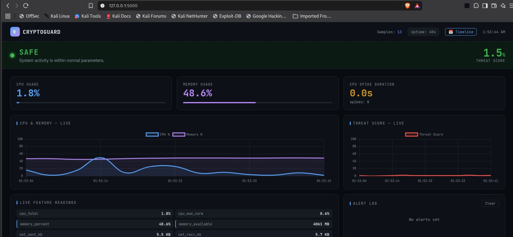
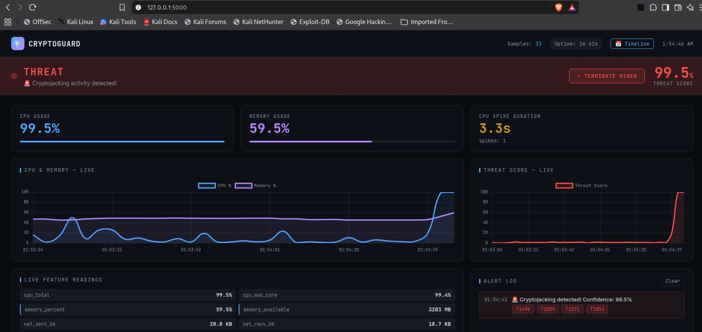
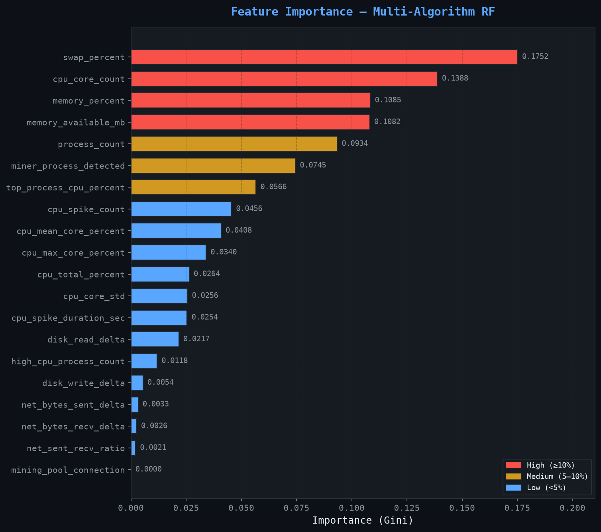
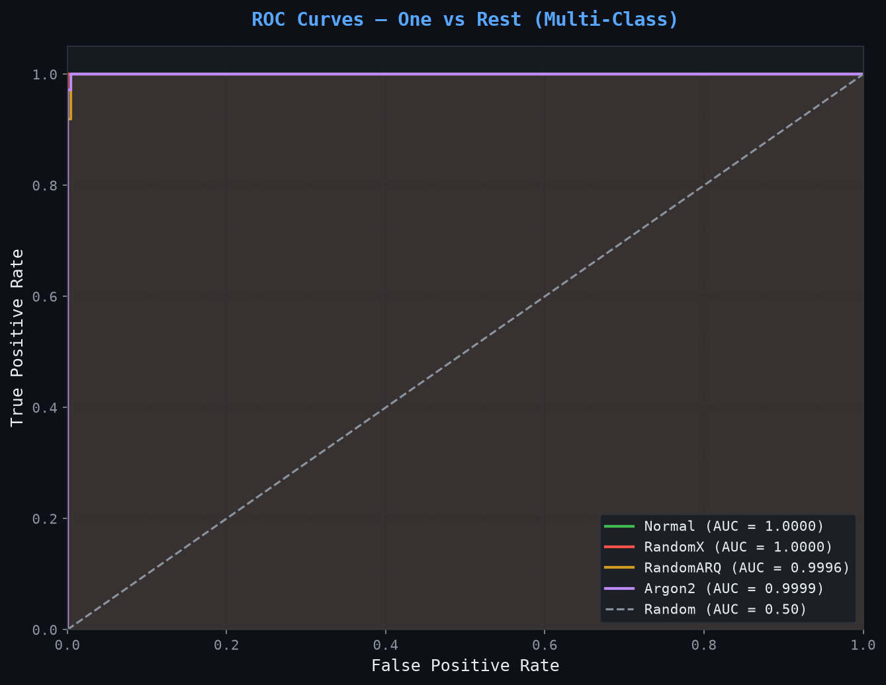

# 🛡️ CryptoGuard — Real-Time Cryptojacking Detection System

> An end-to-end cryptojacking detection platform combining host-based ML detection, network-level packet analysis, MITRE ATT&CK mapping, and SHAP explainability — built as a portfolio security project.

[](https://python.org)
[](https://flask.palletsprojects.com)
[](https://scikit-learn.org)
[](https://shap.readthedocs.io)
[](https://kali.org)
[](LICENSE)

---

## 📸 Screenshots

<table>
  <tr>
    <td><br/><sub><b>Dashboard — SAFE State</b></sub></td>
    <td><br/><sub><b>Dashboard — THREAT Detected</b></sub></td>
  </tr>
  <tr>
    <td><br/><sub><b>Feature Importance</b></sub></td>
    <td><br/><sub><b>ROC Curve (AUC = 1.000)</b></sub></td>
  </tr>
</table>

---

## 📌 What is Cryptojacking?

Cryptojacking is a cyberattack where an attacker secretly runs a cryptocurrency miner on a victim's system — without their knowledge — to earn crypto at the victim's expense. It causes degraded performance, increased electricity costs, hardware wear, and security breaches going undetected.

---

## 🎯 What CryptoGuard Does

```
┌─────────────────────────────────────────────────────────────────┐
│                        CryptoGuard                              │
├──────────────┬──────────────────┬──────────────┬───────────────┤
│  Data Layer  │  Detection Layer │ Network Layer│ Response Layer│
│              │                  │              │               │
│  22 features │  Random Forest   │  Scapy       │  Flask        │
│  2s interval │  200 trees       │  Stratum     │  Dashboard    │
│  SMOTE       │  SHAP explain    │  Port detect │  Kill button  │
│  Multi-algo  │  MITRE ATT&CK    │  Pool DNS    │  Alert log    │
└──────────────┴──────────────────┴──────────────┴───────────────┘
```

---

## ✨ Features

### 🤖 Machine Learning Detection
- **Binary model** — Normal vs Cryptojacking (100% accuracy, F1=1.000)
- **Multi-algorithm model** — Classifies RandomX, RandomARQ, Argon2 (99.62% accuracy)
- **SMOTE** for class imbalance, **5-fold cross-validation** for robustness
- Self-generated labelled dataset (1296 samples across 4 classes)

### 🧠 SHAP Explainability
- Per-prediction feature contribution bars — answers *why* each detection fired
- Live in dashboard: shows which features pushed toward ATTACK vs SAFE
- Standalone report generator with beeswarm and waterfall plots

### 🌐 Network-Level Detection
- Packet capture via Scapy — second independent detection layer
- Detects **Stratum protocol** signatures in packet payloads
- Flags connections to **known mining pool ports** (3333, 4444, 5555, 14433)
- **Reverse DNS** against known pool domain list
- Sustained outbound traffic pattern detection

### 🗺️ MITRE ATT&CK Mapping
- Every detection tagged with relevant ATT&CK techniques
- **T1496** Resource Hijacking, **T1059** Command & Scripting, **T1571** Non-Standard Port, **T1053** Scheduled Task
- ATT&CK Navigator heatmap JSON export
- SOC-style incident report generator

### 🖥️ Real-Time Dashboard
- Live CPU, memory, network, threat score charts
- SAFE / WARNING / THREAT status banner with pulse animation
- ⚡ **Kill button** — terminates miner process (appears only on THREAT)
- 🛡️ **Veto rule** — network traffic check prevents false positives
- 📅 **Threat timeline** — full attack history with duration tracking

### 🌍 Browser Extension
- Chrome, Brave, Firefox compatible (Manifest V3)
- 5-layer detection: domain blocklist, script signatures, Worker interception, WebAssembly monitoring, CPU timing
- Desktop notification + one-click block

### 📊 False Positive Testing
- 7-scenario stress test suite (stress-ng, Python workloads, fork bomb)
- Improved from 3 → 2 false positive scenarios through iterative retraining
- Documented limitation: CPU+Memory combined workloads (inherent to behaviour-based detection)

---

## 📊 Model Performance

### Binary Model (Normal vs Cryptojacking)

| Metric | Score |
|---|---|
| Accuracy | **100%** |
| Precision | **100%** |
| Recall | **100%** |
| F1 Score | **1.000** |
| CV F1 (5-fold) | **1.000 ± 0.000** |
| ROC AUC | **1.0000** |

### Multi-Algorithm Model (4 Classes)

| Metric | Score |
|---|---|
| Accuracy | **99.62%** |
| F1 Score (weighted) | **0.9962** |
| CV F1 (5-fold) | **1.000 ± 0.000** |

### Key Research Finding

> Memory-based features (`memory_percent`, `memory_available_mb`) rank **higher** in importance than CPU features — because XMRig's RandomX algorithm allocates ~2GB RAM. This contradicts most existing literature which focuses primarily on CPU as the primary detection signal.

### Top 5 Features by Importance

| Rank | Feature | Importance |
|---|---|---|
| 1 | `memory_percent` | 0.1801 |
| 2 | `memory_available_mb` | 0.1757 |
| 3 | `miner_process_detected` | 0.1730 |
| 4 | `top_process_cpu_percent` | 0.1231 |
| 5 | `cpu_max_core_percent` | 0.1115 |

### False Positive Test Results

| Scenario | FP Rate | Result |
|---|---|---|
| CPU Stress only | 0.0% | ✅ PASS |
| Memory Stress 1GB | 0.0% | ✅ PASS |
| CPU + Memory Combined | 100% | ⚠️ Known limitation |
| Disk I/O Stress | 10.0% | ⚠️ Minor noise |
| Fork Bomb (many procs) | 0.0% | ✅ PASS |
| Python Matrix Workload | 0.0% | ✅ PASS |
| Idle Baseline | 0.0% | ✅ PASS |

---

## 🚀 Quick Start

### 1. Clone
```bash
git clone https://github.com/Chayesh/cryptoguard.git
cd cryptoguard
```

### 2. Environment
```bash
python3 -m venv venv
source venv/bin/activate
pip install -r requirements.txt
```

### 3. Collect Data
```bash
# Normal activity
python3 collect_data_linux.py --label 0 --session "idle" --duration 600 --output normal_data.csv

# Attack — run XMRig in another terminal first
python3 collect_data_linux.py --label 1 --session "xmrig_full" --duration 600 --output attack_data.csv

# Merge
python3 collect_data_linux.py --merge normal_data.csv attack_data.csv --output full_dataset.csv
```

### 4. Train
```bash
# Binary model
python3 train_model.py --dataset full_dataset.csv

# Multi-algorithm model
python3 train_multi_algo.py --dataset multi_algo_dataset.csv
```

### 5. Run Dashboard
```bash
python3 dashboard.py
# Open → http://localhost:5000
```

### 6. Generate SHAP Report
```bash
python3 shap_explainer.py --model cryptojacking_model.pkl \
                           --scaler scaler.pkl \
                           --dataset full_dataset.csv
```

### 7. Run MITRE ATT&CK Report
```bash
python3 mitre_report.py
# Outputs navigator JSON + incident report to mitre_output/
```

### 8. Browser Extension
```
Chrome/Brave → chrome://extensions/ → Developer mode → Load unpacked → select cryptoguard-extension/
Firefox      → about:debugging → Load Temporary Add-on → select manifest.json
```

---

## 📁 Project Structure

```
cryptoguard/
│
├── 📊 Data & Training
│   ├── collect_data_linux.py       # 22-feature data collector
│   ├── train_model.py              # Binary RF training pipeline
│   ├── train_multi_algo.py         # Multi-algorithm 4-class model
│   └── retrain_fix2.py             # Improved model with memory-heavy data
│
├── 🤖 Detection & Analysis
│   ├── dashboard.py                # Real-time Flask dashboard
│   ├── network_detector.py         # Scapy packet capture layer
│   ├── shap_explainer.py           # SHAP explainability module
│   ├── mitre_mapping.py            # ATT&CK technique mapper
│   ├── mitre_report.py             # SOC report + navigator heatmap
│   └── timeline.py                 # Threat timeline view
│
├── 🧪 Testing
│   └── stress_test.py              # 7-scenario false positive suite
│
├── 🌍 Browser Extension
│   └── cryptoguard-extension/
│       ├── manifest.json
│       ├── background.js           # Detection engine
│       ├── content.js              # Page injection
│       ├── popup.html/js           # Extension UI
│       └── mining_block_rules.json # Domain blocklist
│
├── 📈 Results
│   ├── results/                    # Binary model plots
│   ├── results_v2/                 # v1 vs v2 comparison
│   ├── results_multi/              # Multi-algo plots
│
└── 📄 Config
    ├── requirements.txt
    ├── .gitignore
    └── LICENSE
```

---

## ⚙️ Tech Stack

| Component | Technology |
|---|---|
| Language | Python 3.10+ |
| ML Model | scikit-learn RandomForestClassifier |
| Explainability | SHAP TreeExplainer |
| Imbalance Handling | imbalanced-learn SMOTE |
| Web Dashboard | Flask + Chart.js |
| Packet Capture | Scapy |
| System Monitoring | psutil |
| Browser Extension | Manifest V3 (Chrome/Brave/Firefox) |
| Attack Simulator | XMRig (benchmark mode) |
| Platform | Kali Linux (VMware) |

---

## 🗺️ MITRE ATT&CK Coverage

| Technique | Name | Tactic |
|---|---|---|
| T1496 | Resource Hijacking | Impact |
| T1496.001 | Compute Hijacking | Impact |
| T1059 | Command & Scripting Interpreter | Execution |
| T1036 | Masquerading | Defense Evasion |
| T1053 | Scheduled Task/Job | Persistence |
| T1571 | Non-Standard Port | Command & Control |

---

## 🔁 Model Improvement Pipeline

```
v1 — Baseline
├── Dataset: idle + compiling sessions (934 rows)
├── Accuracy: 100% (binary)
└── False positives: 3/7 stress scenarios

        ↓ Fix 2: Added memory-heavy normal data
        ↓ Fix 3: Network veto rule (5KB/s threshold)

v2 — Improved
├── Dataset: +memory stress sessions (1296 rows)
├── Accuracy: 100% binary | 99.62% multi-algo
└── False positives: 2/7 stress scenarios ✅

        ↓ Multi-algorithm extension

v3 — Multi-Algorithm
├── 4 classes: Normal, RandomX, RandomARQ, Argon2
├── Each algorithm has distinct memory signature
└── swap_percent + cpu_core_count emerged as key features
```

---

## ⚠️ Ethical Notice

This project is developed strictly for **research and educational purposes**.

- XMRig runs in **offline benchmark mode** (`--bench=1M`) — no cryptocurrency is mined
- All data collected on **personally owned systems only**
- Attack simulations in an **isolated VM environment**
- This tool is for **detection**, not for facilitating attacks

---

## 📄 License

MIT License — see [LICENSE](LICENSE) for details.

---

## 👤 Author

**Chayesh Kumar M L**

[](https://linkedin.com/in/chayesh-kumar)
[](https://github.com/Chayesh)

---

## 🙏 Acknowledgements

- [XMRig](https://github.com/xmrig/xmrig) — open source miner used as attack simulator
- [scikit-learn](https://scikit-learn.org) — ML framework
- [SHAP](https://shap.readthedocs.io) — explainability library
- [Scapy](https://scapy.net) — packet capture library
- [psutil](https://github.com/giampaolo/psutil) — system monitoring
- [Flask](https://flask.palletsprojects.com) — web framework
- [MITRE ATT&CK](https://attack.mitre.org) — threat intelligence framework
